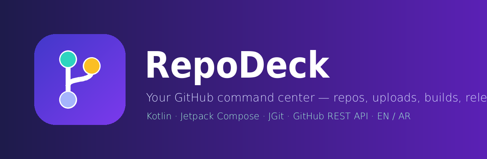
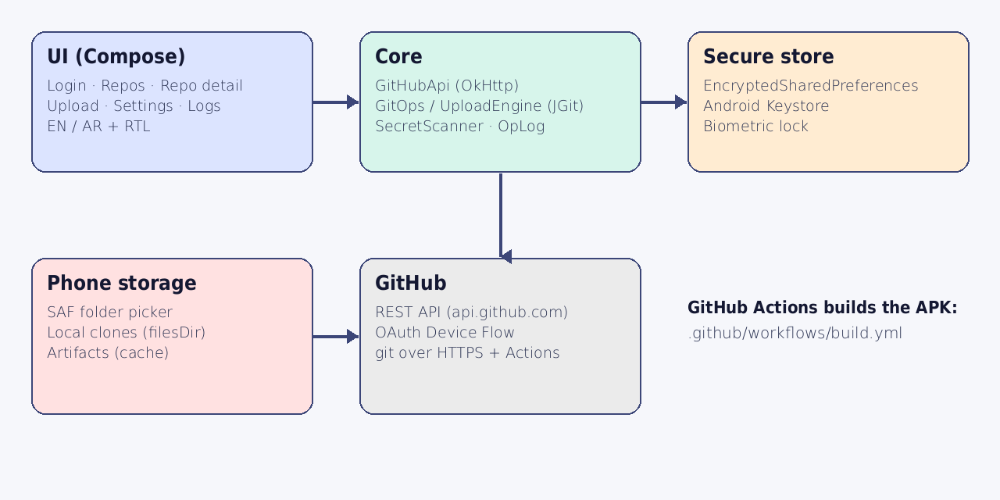
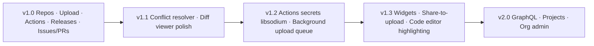

   
  <b>RepoDeck</b> — a real, native Android client for GitHub. 
  <a href="#english">English</a> · <a href="#arabic">العربية</a>

---

## English

RepoDeck talks directly to the **GitHub REST API** and runs **real Git (JGit)** on the phone. There is no mock data and no simulation anywhere in the code: every list, log and artifact you see comes from GitHub.

### Features (implemented)

| Area | What works |
|---|---|
| Account | OAuth **Device Flow** (no client secret) or Personal Access Token, multiple accounts, encrypted token storage (Android Keystore), token scopes & API rate limit view, biometric / screen-lock app lock |
| Repositories | Full paginated list, search, filters (private/public/forks/archived/owned), create (user or org, README, `.gitignore`, license, template), edit name/description/visibility/default branch, archive/unarchive, fork, generate from template, transfer ownership, delete with typed-name confirmation, bulk archive/delete |
| Files | Browse any branch, view/edit text files with commits, create, upload from phone, rename, delete |
| Git | Branches (create/delete/switch), tags, compare, merge, commit history & diffs, **on-device clone / pull / status / commit & push / checkout** via JGit |
| Upload project | Pick a folder from phone storage → scan → upload to a new or existing repo via real `git push`. Secret scanner blocks `.env`, keystores, private keys, tokens, files > 100 MB. Auto-skips `build/`, `node_modules/`… Optional smart `.gitignore` |
| Collaboration | Issues, pull requests (create, comment, merge/squash/rebase, approve / request changes), labels, milestones, collaborators |
| Build & release | Detect project type, add workflow templates (Android / Node), dispatch workflows, live run list with auto-refresh + notification on completion, jobs & step status, **real job logs and full log zip**, re-run / re-run failed / cancel, download artifacts, verify (SHA-256 + zip integrity), **install APK**, create releases and attach files |
| Files & search | Markdown preview for `.md` files, GitHub code search inside a repo (content or file name) |
| Build diagnosis | **Diagnose failure** reads the failed job log and gives likely causes + concrete fixes (Gradle, Android, npm, permissions, signing…) |
| Widget | Home-screen widget with the real status of the latest build of the pinned repo (Actions › Pin to widget) |
| Admin | Webhooks, deploy keys, notifications inbox |
| Platform | Operations log (success/failure, persisted), storage manager, settings export/import **without secrets**, English + Arabic with full RTL |

### Honest limits

* **Git LFS** is not supported by JGit; files over 100 MB are blocked and reported instead of failing silently.
* Conflict resolution UI, libsodium-encrypted **Actions secrets** upload, and background (WorkManager) upload queue are on the roadmap, not implemented.
* Some operations depend on your account / token permissions (transfer, webhooks, org admin). GitHub's real error message is shown when an operation is not allowed.
* `gradlew`'s executable bit cannot be preserved when uploading from Android storage; the generated workflow runs `chmod +x ./gradlew`.

### Build the APK

**GitHub Actions (recommended):** push this folder to a repo (you can do it with RepoDeck itself) — `.github/workflows/build.yml` builds debug + release APKs and uploads them as artifacts. Push a tag like `v1.0.0` to publish a Release.
Optional secrets for a signed release: `KEYSTORE_BASE64`, `KEYSTORE_PASSWORD`, `KEY_ALIAS`, `KEY_PASSWORD`.

**Locally:** Android Studio (Koala+) → open the folder → Run. Or `gradle assembleDebug` with Gradle 8.9 and JDK 17.

### One-tap "Continue with GitHub" (like Manus)

Register **one** OAuth App (GitHub → Settings → Developer settings → OAuth Apps, tick **Enable Device Flow**), then add its Client ID as a repository **variable** named `OAUTH_CLIENT_ID` (Settings → Secrets and variables → Actions → Variables). Every build then ships with a single **Continue with GitHub** button: the app copies the code and opens GitHub in the browser. No client secret is ever inside the app.

### Downloads that stay

Artifacts and APKs you download are kept in the app (**Downloads** tab, survive restarts / clear cache) and also copied to `Download/RepoDeck` on the phone. The CI builds a single `RepoDeck.apk` (release) and uploads it as the artifact and to the release.

### First sign-in (manual options)

1. GitHub → Settings → Developer settings → OAuth Apps → *New* → tick **Enable Device Flow**.
2. Paste the **Client ID** in the app → *Start device login* → enter the code on GitHub.
3. Or use a Personal Access Token with `repo workflow delete_repo read:org admin:repo_hook notifications`.

### Architecture

### Roadmap

Screenshots are intentionally not included until the first build is installed and captured from a real device.

---

## العربية

**RepoDeck** تطبيق أندرويد أصلي يتصل مباشرة بـ **GitHub REST API** ويشغّل **Git حقيقي (JGit)** على الهاتف. لا توجد أي بيانات تجريبية أو محاكاة في الكود: كل قائمة وسجل وملف ناتج تراه يأتي من GitHub.

### الميزات المنفذة

- **الحساب:** تسجيل دخول OAuth Device Flow (بدون client secret) أو توكن شخصي، عدة حسابات، تخزين مشفر بـ Android Keystore، عرض الصلاحيات واستهلاك API، قفل التطبيق بالبصمة.
- **المستودعات:** عرض كامل مع بحث وفلاتر، إنشاء (مستخدم/منظمة)، تعديل، أرشفة، Fork، قوالب، نقل ملكية، حذف بتأكيد كتابة الاسم، وعمليات جماعية.
- **الملفات وGit:** تصفح وتعديل ورفع وإعادة تسمية وحذف، فروع ووسوم ومقارنة ودمج، وClone / Pull / Commit / Push فعلي على الجهاز.
- **رفع مشروع:** اختيار مجلد من الهاتف ← فحص ← رفع عبر `git push` حقيقي، مع فاحص أسرار يمنع `.env` والمفاتيح والتوكنات والملفات الأكبر من 100MB.
- **التعاون:** Issues وPull Requests ومراجعات وتعليقات وLabels وMilestones وCollaborators.
- **البناء والإصدارات:** قوالب Workflows، تشغيل وإلغاء وإعادة تشغيل، سجلات حقيقية لكل Job، تنزيل Artifacts مع التحقق (SHA-256) وتثبيت APK، وإنشاء Releases مع إرفاق ملفات.
- **الإدارة:** Webhooks وDeploy Keys والإشعارات، سجل عمليات، نسخ احتياطي للإعدادات **بدون أسرار**، واجهة عربية وإنجليزية كاملة مع RTL.

### حدود صريحة

- Git LFS غير مدعوم في JGit؛ الملفات الأكبر من 100MB تُمنع وتظهر في التقرير.
- واجهة حل التعارضات، ورفع Actions Secrets بتشفير libsodium، وطابور الرفع في الخلفية موجودة في خارطة الطريق وليست منفذة بعد.
- بعض العمليات تعتمد على صلاحيات حسابك (نقل الملكية، Webhooks، إدارة المنظمات) ويظهر رد GitHub الحقيقي عند عدم السماح.

### البناء

ارفع المجلد إلى مستودع (ويمكنك ذلك بالتطبيق نفسه) وسيبني `.github/workflows/build.yml` ملفات APK ويرفعها كـ Artifacts. أو افتحه في Android Studio وشغّله.

## License

MIT
